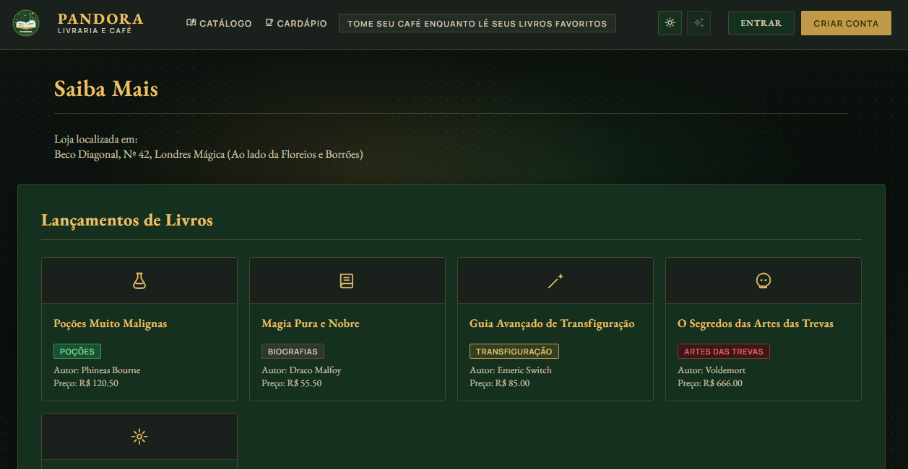

<p align="center">
  
</p>

<h1 align="center">📚☕ Pandora Livraria & Café</h1>

<p align="center">
  <em>Tome seu café enquanto lê seus livros favoritos, no coração do Beco Diagonal.</em>
</p>

<p align="center">
  <a href="https://pandora-livraria-e-cafe.onrender.com">
    
  </a>
</p>

<p align="center">
  
  
  
  
  
</p>

<p align="center">
  <a href="https://pandora-livraria-e-cafe.onrender.com">
    
  </a>
</p>

<p align="center">
  <sub>⏳ Hospedado no plano gratuito do Render: se o site ficar um tempo sem acessos, o primeiro carregamento pode levar cerca de 50 segundos para "acordar" o servidor.</sub>
</p>

---

Um projeto de estudo Full-Stack focado no desenvolvimento de um sistema web completo para uma livraria mágica fictícia do universo de **Harry Potter**, localizada no **Beco Diagonal**.

Começou do zero, **sem frameworks**, com o objetivo de aprender e consolidar os fundamentos da web (manipulação do DOM, requisições HTTP, modelagem de banco de dados e estilização). Com os fundamentos consolidados, o front-end inteiro foi migrado para **React + React Router** — uma SPA de verdade, com rotas reais em vez de arquivos `.html` soltos — pra deixar mais rápido criar cada página nova (ex.: a página de um livro específico, uma campanha/anúncio). O back-end continua em Node.js puro (`http`, `fs`, `crypto`, sem Express), por escolha, pra aprofundamento técnico.

## 🎯 Objetivo do Projeto (Produto Final)
O sistema final permitirá que os clientes naveguem pelo acervo de grimórios e livros mágicos, vejam os lançamentos, descubram promoções (de livros e do café) e façam login para reservar obras e retirar na loja física. Além disso, contará com um painel administrativo para controle interno do estoque e cadastro de novas campanhas.

## 🛠️ Tecnologias Utilizadas
* **Front-end:** SPA em **React + Vite** (`app/`), com **React Router** cuidando de todas as rotas (`/`, `/login`, `/cadastro`, `/catalogo`, `/livro/:id`, `/perfil`, `/painel-funcionario`). `JS/canvas.js`, `JS/particulas.js` e `JS/magica.js` continuam como scripts soltos (efeitos visuais, sem estado de aplicação).
* **Back-end:** Node.js (utilizando apenas os módulos nativos como `http`, `fs` e `crypto`, sem frameworks como Express, para aprofundamento técnico). Serve a build do React como "SPA shell": qualquer URL que não seja API nem arquivo estático real cai no `dist/index.html`, e o React Router decide o que mostrar.
* **Armazenamento de dados:** PostgreSQL hospedado no [Supabase](https://supabase.com) (schema em `database/supabase-schema.sql`), acessado via `pg` (driver nativo, sem ORM).
* **Segurança:** Senhas protegidas com hash `scrypt` e *salt* aleatório (módulo nativo `crypto`).
* **Hospedagem:** [Render](https://render.com) (plano gratuito), com deploy automático a cada `git push` na branch `master`.
* **Design:** Logo e favicon em SVG, criados exclusivamente para o projeto.

## 🚀 Funcionalidades do Sistema

### 🟢 O que já está implementado (MVP)
- [x] **Vitrine Dinâmica de Lançamentos:** Renderização de livros alimentados diretamente pelo Postgres (tabela `livros`), via componente React (`<VitrineLivros>`).
- [x] **Vitrine de Promoções Ativas:** Exibe apenas as promoções cadastradas, buscadas do banco em tempo real.
- [x] **API Backend:** Servidor próprio capaz de hospedar arquivos estáticos e prover rotas RESTful de dados (`/api/lancamentos`, `/api/promocoes`, `/api/destaques`).
- [x] **Interface Gráfica Temática:** Design baseado em *Cards* com paleta de cores da casa **Sonserina** (verde esmeralda e prata) como identidade principal, mais uma paleta secundária de tons "joia" (roxo, azul, bronze, carvão) usada nas categorias e badges, pra dar variedade sem perder o tema. Títulos em `Cinzel` (serifa) e corpo em `Inter`.
- [x] **Layout Responsivo:** Adaptado para computador, tablet e celular: no celular os livros e promoções aparecem em duas colunas compactas, os botões do cabeçalho passam para baixo do título e o rodapé fica sempre no fim da tela.
- [x] **Efeitos Visuais Mágicos:** Brilho luminoso interativo que segue o cursor (HTML5 Canvas, `JS/canvas.js`), partículas estelares reagindo aos elementos (`JS/magica.js`), fagulhas mágicas flutuando pela tela (`JS/particulas.js`), ícones com brilho pulsante e um reflexo dourado que varre os cards ao passar o mouse. O brilho que segue o cursor só aparece para quem usa mouse (inclusive no celular ou tablet com mouse conectado) e fica desligado em telas de toque; as animações respeitam a preferência do sistema por "reduzir movimento".
- [x] **Deploy no Ar:** Projeto publicado no Render, com atualização automática a cada `git push`.
- [x] **Identidade Visual:** Logo em SVG fixa no cabeçalho (com link para a página inicial) e favicon na aba do navegador.
- [x] **Páginas de Login e Cadastro:** Telas (`/login` e `/cadastro`, React) no mesmo tema visual da loja, compartilhando o mesmo componente de formulário (`<FormularioAuth>`).
- [x] **Back-end de Autenticação:** Rotas `POST /api/cadastro` e `POST /api/login` com senhas criptografadas (`scrypt` + *salt*) e dois tipos de usuário (`cliente` e `funcionario`), definidos automaticamente pelo domínio do e-mail no cadastro.
- [x] **Login e Cadastro Funcionando:** Os formulários enviam os dados à API, mostram mensagens de erro e, ao entrar, o cabeçalho exibe um link "Olá, ..." com o botão "Sair".
- [x] **Redirecionamento por Tipo de Conta:** Depois de entrar, cliente vai para `/perfil` e funcionário/admin vai para `/painel-funcionario` — cada rota protegida por um componente `<RotaProtegida>` que só deixa passar o tipo de conta certo (e manda quem está no tipo errado pro lugar certo, não pra fora do site).
- [x] **Contas de Teste Fixas:** Um cliente e um funcionário/admin sempre disponíveis para demonstração (veja a seção abaixo).
- [x] **Proteção de Arquivos Internos:** O servidor não entrega o código nem outros arquivos privados pelo navegador.
- [x] **Persistência de Dados:** Usuários, livros, promoções e empréstimos ficam no Postgres (Supabase) — não somem mais a cada deploy/reinício do Render. Automação em `.github/workflows/supabase-manutencao.yml` mantém o projeto Supabase ativo e roda uma limpeza mensal (veja `database/SUPABASE.md`).
- [x] **API de Destaques:** Rota `/api/destaques` que retorna os livros mais bem avaliados e os mais vendidos.
- [x] **Painel da Equipe:** Área restrita a funcionário/admin (`/painel-funcionario`) com um resumo (total de livros, estoque baixo, promoções, empréstimos ativos/atrasados/pendentes) e quatro abas: **Promoções** (criar, editar, remover), **Biblioteca** (cadastrar livro, editar dados e estoque, remover), **Empréstimos** (registrar empréstimo manualmente, aprovar/rejeitar pedidos feitos pelo site, marcar devolução, status `solicitado`/`ativo`/`atrasado`/`devolvido`/`rejeitado`/`cancelado` calculado automaticamente) e **Clientes** (lista de contas cadastradas, com busca por nome/e-mail).
- [x] **Catálogo e Página de Livro:** `/catalogo` lista todo o acervo com filtro por categoria; cada livro abre em `/livro/:id` com os detalhes completos.
- [x] **Empréstimo pelo Site:** Cliente logado solicita o empréstimo direto na página do livro (vira um pedido com status `solicitado`, sem baixar o estoque ainda); a equipe aprova (baixa o estoque, status `ativo`) ou rejeita pelo painel, e o próprio cliente pode cancelar um pedido ainda não aprovado. Acompanha tudo em "Meus Empréstimos", dentro de `/perfil`.
- [x] **Destaques na Página Inicial:** A home mostra os livros mais vendidos e mais bem avaliados (`/api/destaques`), com cards clicáveis que levam direto pra página do livro.
- [x] **Sessão por Token Assinado:** Login e cadastro emitem um token (HMAC-SHA256, assinado com `SESSION_SECRET`, válido por 7 dias). Toda rota restrita (`/api/admin/...`, empréstimos do cliente) exige esse token no header `Authorization: Bearer ...` e reconfirma a conta no banco a cada chamada — substitui o header `x-usuario-email` (que qualquer visitante podia forjar pra se passar por outra conta).

### 🟡 O que está no Roadmap (Próximos Passos)
- [ ] **Sistema de Reservas:** Interface para o usuário autenticado selecionar grimórios para retirada presencial.
- [ ] **Notificação de Empréstimo:** Avisar o cliente (e-mail ou na tela) quando a equipe aprovar ou rejeitar um pedido.
- [x] **Migração completa para React:** Site inteiro virou uma SPA em React + Vite + React Router, substituindo os arquivos `.html` soltos e os scripts de página (`lancamento.js`, `promocoes.js`, `auth.js`). Deixa criar páginas novas só adicionando uma rota, sem mexer no servidor.
- [x] **Painel da Equipe Completo:** Gerenciamento de promoções, estoque/biblioteca, empréstimos e clientes (veja acima).
- [x] **Persistência dos Dados:** Migrado de arquivos JSON para Postgres no Supabase (veja acima).
- [x] **Catálogo, Página de Livro e Empréstimo pelo Site:** veja acima.
- [x] **Sessão Segura de Usuário:** veja acima.

## 🔑 Contas de Teste

Para experimentar o site sem precisar cadastrar nada, use uma destas contas (recriadas sempre que o servidor liga):

| Tipo | E-mail | Senha |
|---|---|---|
| Cliente | `cliente@gmail.com` | `cliente123` |
| Funcionário / Admin | `funcionario@pandoralivraria.com.br` | `equipe123` |

> O tipo da conta é definido pelo domínio do e-mail no cadastro: quem usa `@pandoralivraria.com.br` vira funcionário/admin, qualquer outro domínio (Gmail, Outlook, etc.) vira cliente.

> ⚠️ São contas públicas de demonstração, então nunca use nelas uma senha real. Diferente de antes (quando o site usava JSON), contas criadas pelo formulário de cadastro agora ficam salvas no Postgres e sobrevivem a reinícios/deploys do Render.

## 📂 Estrutura do Projeto

Abaixo está o mapa para você se encontrar dentro dos arquivos do projeto:

```text
📁 Raiz
 ├── 📁 CSS
 │    └── 📄 style.css              # Estilos visuais (tema Sonserina e UI)
 ├── 📁 JS                          # Scripts soltos: só efeitos visuais, sem estado de aplicação
 │    ├── 📄 canvas.js              # Lógica da varinha mágica luminosa (Canvas 2D)
 │    ├── 📄 magica.js              # Lógica das partículas e estrelas interativas (rota /testes)
 │    └── 📄 particulas.js          # Fagulhas mágicas flutuando pela tela (decorativo)
 ├── 📁 database
 │    ├── 📄 supabase-schema.sql                     # Schema Postgres (tabelas + acervo inicial), roda no SQL Editor do Supabase
 │    ├── 📄 migracao-solicitacao-emprestimo.sql     # ALTER TABLE pra bancos já existentes (fluxo de empréstimo solicitado)
 │    ├── 📄 migracao-cancelamento-emprestimo.sql    # ALTER TABLE pra bancos já existentes (status 'cancelado')
 │    ├── 📄 supabase-limpeza-mensal.sql             # Função de limpeza mensal do banco
 │    └── 📄 SUPABASE.md                             # Como conectar o servidor ao Supabase e ativar a automação
 ├── 📁 imagens
 │    ├── 📄 logo.svg               # Logo do projeto (cabeçalho, favicon e README)
 │    └── 📄 preview.png            # Print do site usado no README
 ├── 📁 app                         # Código-fonte React (Vite) do site inteiro
 │    ├── 📁 src
 │    │    ├── 📄 main.jsx                  # Ponto de entrada (monta o <BrowserRouter>)
 │    │    ├── 📄 App.jsx                   # Define as rotas (React Router)
 │    │    ├── 📄 sessao.js                 # Ler/salvar sessão, sair, decidir página por tipo de conta
 │    │    ├── 📄 icones.js                 # Ícones SVG por categoria de livro (compartilhado)
 │    │    ├── 📄 api.js                    # Chamadas fetch compartilhadas (login/cadastro, admin)
 │    │    ├── 📁 componentes
 │    │    │    ├── 📄 Cabecalho.jsx        # Cabeçalho único de todo o site
 │    │    │    ├── 📄 Rodape.jsx
 │    │    │    ├── 📄 VitrineLivros.jsx    # Grid de livros (/api/lancamentos)
 │    │    │    ├── 📄 VitrinePromocoes.jsx # Grid de promoções (/api/promocoes)
 │    │    │    ├── 📄 VitrineDestaques.jsx # Mais vendidos/avaliados (/api/destaques)
 │    │    │    ├── 📄 FormularioAuth.jsx   # Formulário de login/cadastro
 │    │    │    └── 📄 RotaProtegida.jsx    # Guarda de rota por tipo de conta
 │    │    └── 📁 paginas                   # Uma por rota: Inicio, Login, Cadastro, Catalogo, Livro,
 │    │                                     # Perfil, PainelEquipe, Teste, NaoEncontrada
 │    ├── 📄 index.html              # HTML base usado pelo Vite (carrega canvas.js/particulas.js)
 │    ├── 📄 vite.config.js          # Configuração de build (gera a pasta /dist)
 │    └── 📄 package.json            # Dependências do app React (react, react-router-dom, vite)
 ├── 📁 dist                        # Build gerada do app/ (gerado por `npm run build`, servida como SPA)
 ├── 📄 servidor-estatico.js        # Backend (Servidor Node.js, conexão Postgres, rotas de API e SPA shell)
 ├── 📄 package.json                # Dependências e scripts (npm start, npm run dev, npm run build)
 ├── 📄 package-lock.json           # Versões exatas das dependências
 ├── 📄 .env.example                # Modelo da variável DATABASE_URL (copiar para .env)
 ├── 📄 .gitignore                  # Arquivos ignorados pelo Git (node_modules, .env)
 ├── 📄 GUIA-SERVIDOR.md            # Documentação técnica de como o Node funciona
 └── 📄 README.md                   # Esta documentação
```

## 💻 Como Rodar o Projeto Localmente

O servidor precisa de um banco Postgres (Supabase) pra rodar — veja [`database/SUPABASE.md`](database/SUPABASE.md) pra criar o projeto e as tabelas antes do passo 4. Também é necessário ter o [Node.js](https://nodejs.org) instalado.

1. **Clone o repositório** e entre na pasta:
   ```bash
   git clone https://github.com/GehMay/Pandora-Livraria-E-Cafe.git
   cd Pandora-Livraria-E-Cafe
   ```
2. **Instale as dependências:**
   ```bash
   npm install
   ```
3. **Configure as variáveis de ambiente:** copie `.env.example` para `.env` e preencha `DATABASE_URL`
   com a *connection string* do Supabase (detalhes em `database/SUPABASE.md`) e gere um `SESSION_SECRET`
   (usado pra assinar os tokens de login — o próprio `.env.example` mostra o comando pra gerar um).
4. **Inicie o servidor** (usa `npm run dev` em vez de `npm start` pra carregar o `.env`):
   ```bash
   npm run dev
   ```
5. Abra seu navegador e acesse: [http://localhost:5500](http://localhost:5500)

> 💡 A porta padrão é a `5500`. Se a variável de ambiente `PORT` estiver definida (como acontece no Render), o servidor usa o valor dela. No Render, `DATABASE_URL` e `SESSION_SECRET` são configuradas direto no painel (Environment), então lá o comando usado é o `npm start` normal.

### ⚛️ Mexendo no site em React (`app/`)

O site inteiro é gerado na pasta `/dist`. Rodar `npm run dev` na raiz (passo 4 acima) sozinho já é suficiente pra navegar em tudo. Altere o `app/` para editar qualquer página — veja a tabela de rotas abaixo pra saber onde mexer:

| Rota | Arquivo |
|---|---|
| `/` | `app/src/paginas/PaginaInicio.jsx` |
| `/login` | `app/src/paginas/PaginaLogin.jsx` |
| `/cadastro` | `app/src/paginas/PaginaCadastro.jsx` |
| `/catalogo` | `app/src/paginas/PaginaCatalogo.jsx` |
| `/livro/:id` | `app/src/paginas/PaginaLivro.jsx` |
| `/perfil` | `app/src/paginas/PaginaPerfil.jsx` |
| `/painel-funcionario` | `app/src/paginas/PaginaPainelEquipe.jsx` |

**Pra criar uma página nova** (ex.: a página de um livro específico): crie o componente em `app/src/paginas/`, adicione uma `<Route>` em `app/src/App.jsx` — nada no servidor precisa mudar, o `servidor-estatico.js` já serve qualquer rota nova através da SPA.

1. **Modo desenvolvimento** (com hot reload, mas ainda precisa do servidor Node rodando em outro terminal pra API/CSS/imagens funcionarem):
   ```bash
   cd app
   npm install
   npm run dev
   ```
2. **Gerar o build de novo** depois de editar o React (o servidor Node serve o site a partir da pasta `/dist`, então esse passo é obrigatório antes de commitar):
   ```bash
   npm run build
   ```

---

## 👩‍💻 Autoria

Desenvolvido com dedicação por **Geovanna** como projeto prático de aprimoramento em Desenvolvimento Web Full-Stack.

---

## 📜 Licença

Este projeto está licenciado sob a **Creative Commons Attribution-ShareAlike 4.0 International (CC BY-SA 4.0)**.

Isso significa que você **pode**:
- ✅ Compartilhar — copiar e redistribuir o material em qualquer formato.
- ✅ Adaptar — remixar, transformar e criar a partir do material para qualquer finalidade.

Desde que você **respeite as seguintes condições**:
- 📌 **Atribuição:** Você deve dar o crédito apropriado à autora original (Geovanna), indicar se foram feitas alterações e fornecer um link para a licença.
- 📌 **CompartilhaIgual:** Se você remixar ou transformar este projeto, deve distribuir suas contribuições sob a **mesma licença** que o original.

Licença completa disponível em: https://creativecommons.org/licenses/by-sa/4.0/deed.pt
